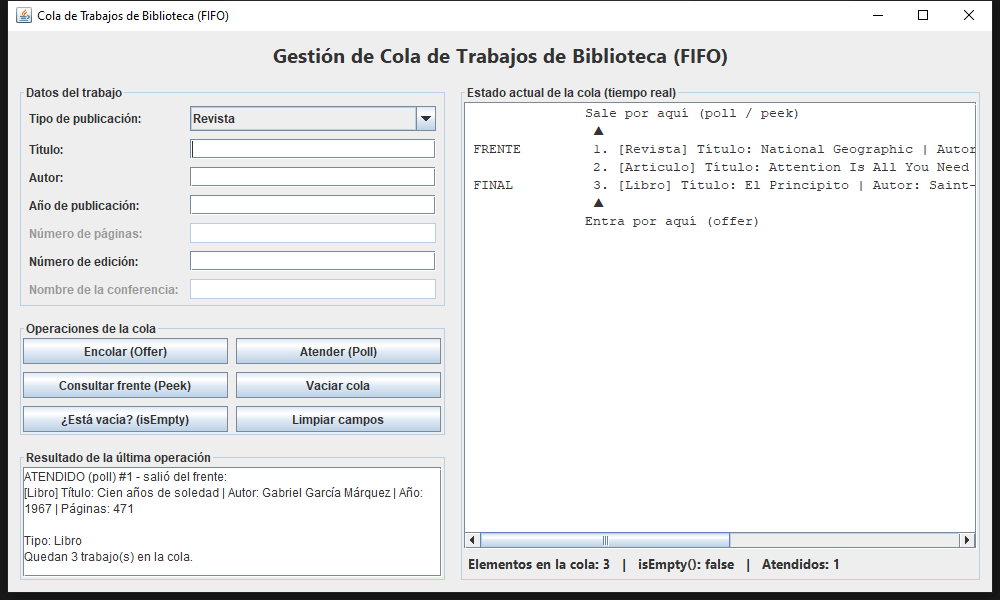

# Actividad 4.2 — Cola de Trabajos de Biblioteca (FIFO)

**Integrantes:**
- Barrutiea Nulutagua Juan Alexander
- Alcala Bejarano Jennifer Paola

Sistema en Java Swing (NetBeans GUI Builder) para gestionar documentos de una biblioteca con una
**cola dinámica (FIFO)** implementada con nodos enlazados. Se reutiliza la jerarquía de herencia
`Trabajo` → `Libro`, `Revista`, `Articulo`, y todas las publicaciones se manejan de forma polimórfica
como `Trabajo`.



## Estructura elegida: Opción B — `ColaTrabajos` (FIFO)

| Método | Descripción |
|---|---|
| `offer(Trabajo)` / `enqueue` | Encola un trabajo al **final** de la cola |
| `poll()` / `dequeue` | Atiende, remueve y devuelve el trabajo del **frente** |
| `peek()` | Consulta el frente sin removerlo |
| `isEmpty()` | Indica si la cola está vacía |
| `vaciarCola()` | Elimina todos los trabajos |
| `size()`, `listar()`, `verFinal()` | Apoyo para la vista en tiempo real |

`poll()` y `peek()` sobre una cola vacía lanzan `IllegalStateException`; la interfaz lo revisa antes y
muestra un mensaje de advertencia.

## Estructura del proyecto (Maven)

```
src/main/java/
├── BackEnd/
│   ├── Trabajo.java        clase base abstracta (titulo, autor, anioPublicacion)
│   ├── Libro.java          + numeroPaginas
│   ├── Revista.java        + numeroEdicion
│   ├── Articulo.java       + nombreConferencia
│   ├── ColaTrabajos.java   cola dinámica con nodos enlazados
│   └── PruebasCola.java    pruebas de funcionamiento por consola
└── FrontEnd/
    ├── TestColaTrabajos.form   diseño del GUI Builder
    └── TestColaTrabajos.java   ventana principal (clase main)
```

## Interfaz

- **Tipo de publicación** (`JComboBox`): habilita solo el campo de la subclase elegida
  (páginas, edición o conferencia) y deshabilita los demás.
- **Botones:** Encolar (Offer), Atender (Poll), Consultar frente (Peek), Vaciar cola,
  ¿Está vacía? (isEmpty) y Limpiar campos.
- **Estado de la cola** (`JTextArea`): se redibuja después de cada operación, marcando el **FRENTE**
  y el **FINAL**, con el número de elementos y el valor de `isEmpty()`.

## Validaciones

- `titulo`, `autor` y `nombreConferencia` no pueden estar vacíos.
- `anioPublicacion`, `numeroPaginas` y `numeroEdicion` deben ser enteros mayores a cero
  (el año, además, no puede ser mayor al actual).
- Se valida en la interfaz (mensaje claro y foco en el campo incorrecto) y también en los
  constructores del modelo.
- Atender, consultar o vaciar con la cola vacía muestra una advertencia.

## Pruebas de funcionamiento

`BackEnd.PruebasCola` comprueba automáticamente los cinco puntos de la actividad:

1. Inserción de `Libro`, `Revista` y `Articulo` (herencia y polimorfismo).
2. Extracción consecutiva en orden FIFO estricto.
3. `peek()` no modifica la estructura.
4. Rechazo de datos inválidos o incompletos.
5. `vaciarCola()` deja `isEmpty() == true`.

Resultado: **24 aprobadas, 0 falladas.**

## Cómo ejecutar

En NetBeans: *File → Open Project*, seleccionar esta carpeta y ejecutar (F6).
`FrontEnd.TestColaTrabajos` es la clase principal. Para las pruebas de consola, clic derecho en
`PruebasCola.java` → *Run File*.

Requiere JDK 17 o superior.
